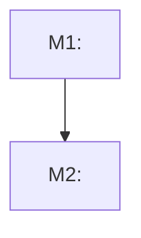

# Stepwise Planner

## Outcome

Produce a markdown plan that matches the requested planning level and lets the next engineer or agent act without guessing the intended scope. Give every standalone executable task, and every inline task prepared for immediate handoff, the bounded `Execution Record` defined by the shared folder convention. Keep Markdown authoritative for scope, dependencies, acceptance checks, material decisions, and current handoff state; do not embed raw evidence, private traces, or vendor-specific orchestration logic.

## Planning Root Compatibility

Resolve plan paths using the single planning-root rule in the shared
`folder-structure` convention. The hierarchy and filename examples below
apply relative to that resolved planning root.

- High-level plans define epics, milestones, or phases as dependency graph nodes with architectural propositions, decisions, questions, risks, and validation points.
- Phase documents consist of stable-ID `T<N>` implementation tasks, not steps.
- Low-level plans divide a phase, feature, fix, or refactor into small implementation tasks that can be reviewed and verified independently; they are not dependency graphs by default.
- High-level `Depends on` fields are authoritative. High-level Mermaid diagrams are derived views, and parallelism metadata is optional.

## Optional Graph Discovery

During repository discovery, read and apply the package-local
[Optional Graph Discovery Policy](references/optional-graph-discovery.md).
Graphify remains an optional candidate locator. If the policy or an already
available permitted index cannot be used, skip Graphify and inspect the
repository directly; planning scope, dependencies, decisions, and evidence
still come only from authoritative sources.

## Choose the Planning Level

Use **high-level planning** when the user asks for a roadmap, milestone list, phase plan, architecture direction, or the parts of a single milestone. High-level plans should clarify system direction and tradeoffs before implementation details.

Use **low-level planning** when the user asks to divide a phase, feature, bug fix, refactor, or already-chosen direction into implementation tasks. Low-level plans may refer to existing or planned code entities, files, APIs, tests, modules, data shapes, and verification commands.

If the requested level is unclear, infer from scale:

- Broad goal, multi-module initiative, or architecture uncertainty: high-level.
- Concrete feature/fix/refactor with known target behavior: low-level.
- Ask only when the ambiguity would materially change the output.

## Workflow

1. Inspect the current project context before planning.
   - Read the smallest applicable instruction and documentation chain, then inspect only the architecture, plans, module boundaries, code, and tests that materially affect the requested plan.
   - If local instructions conflict with the requested direction, raise the conflict before writing the plan.
   - Prefer the repository's current tools, testing style, naming, and planning conventions.

2. Define the planning target.
   - State the goal in one paragraph.
   - State explicit non-goals when they prevent speculative scope.
   - List assumptions and unknowns. Ask only for unknowns that would materially change the plan.

3. Build the plan at the chosen level.
   - Assign every epic, milestone, phase, or task a stable ID.
   - Use `E<N>` for epics, `M<N>` for milestones, `P<N>` for phases, and `T<N>` for low-level implementation tasks.
   - When writing one epic, milestone, phase, or task per file, name the file `{identifier} - {name}.md`, for example `M1 - Authentication foundation.md`.
    - Store documents under the resolved planning root using full `{identifier} - {name}.md` filenames and ID-only parent directories.
   - In that hierarchy, `{epic}`, `{milestone}`, `{phase}`, and `{task}` are full document filenames using `{identifier} - {name}.md`; `{epic-id}`, `{milestone-id}`, and `{phase-id}` are ID-only directory names such as `E1`, `M1`, and `P1`.
   - For high-level planning, organize milestones or phases around capabilities, architecture decisions, ownership boundaries, and validation points.
   - When planning inside a phase, represent the phase's contents as `T<N>` tasks.
   - For low-level planning, slice the work into small reviewable implementation tasks with stable `T<N>` IDs.
   - Keep a single straightforward outcome as one concise task; do not invent extra tasks or a dependency graph merely to make the plan look substantial.
- For every high-level `E<N>`, `M<N>`, or `P<N>` node, include `Depends on`; use `None` when no dependency exists. Add `Parallelizable with` only when it communicates useful, safely established parallelism. Do not require `Enables`; when legacy or repository-local plans include it, treat it as a derived reverse view that cannot override `Depends on`.
- For every generated high-level document, include mandatory document metadata in `Document Context`: `Status` and `Dependencies`, with `Dependencies` reflecting `Depends on`.
   - For every low-level `T<N>` task, include `Purpose`, `Changes`, `Acceptance Checks`, and `Risks`. Add `Prerequisites` only for a hard dependency or readiness condition.
   - A merely planned inline task may omit `Execution Record`. Add the record
     before immediate execution or delegation. When the task needs independent
     writer ownership or an isolated cross-session handoff, extract it lazily
     to `<parent-id>/T<N> - <name>.md`, move rather than copy its intent fields,
     and leave one link at the former inline location.
   - Every standalone executable task document must contain the exact ordered
     `Execution Record` field set from the shared folder convention. Initialize
     it with `Status: Planned`, `Implemented Scope: None`, `Relevant Files and
     Symbols: None`, `Review Outcome: Not Reviewed`, and a specific planned
     resume action. Do not invent execution results or evidence.
   - Tolerate legacy `Depends on`, `Enables`, and `Parallelizable with` fields in existing low-level plans. Interpret legacy task-level `Depends on` as prerequisite information and the other fields as advisory; do not rewrite them solely for format conformity.
   - Avoid speculative foundations unless a later listed milestone, phase, or task directly consumes them.

4. Model dependencies and risk.
   - Put contract, data model, boundary, and architecture decisions before dependent implementation.
   - Put high-uncertainty spikes early, but time-box them and define their output.
   - Put broad cleanup after behavior is covered by tests or reviewable acceptance criteria.
   - Do not encode high-level ordering by document position alone. Express it through authoritative `Depends on` fields.
   - In low-level plans, arrange tasks in the recommended execution order. When `Prerequisites` is absent, document order supplies that recommendation without creating a hard dependency.
   - Reserve `Prerequisites` for hard dependencies or readiness conditions that must be satisfied before a task can start; do not use it for every preferred sequencing choice.
   - Mark optional high-level parallelism only when nodes do not share files, public contracts, ordered migrations, or overlapping test surfaces likely to conflict.

5. Emit the requested markdown document or document set.
   - Use concise headings and checklists.
   - Include enough detail for the chosen level, but do not mix high-level roadmap planning with task-level implementation unless the user asks for both.
   - End high-level documents that plan relationships among `E<N>`, `M<N>`, or `P<N>` nodes with a Mermaid `flowchart TD` dependency visualization derived from authoritative `Depends on` fields.
   - Do not add a Mermaid dependency graph to a low-level plan merely because it contains multiple tasks. Include one only when the user or a stronger repository convention explicitly requires it.
   - Include a `Document Context` section in every generated planning document.
   - Keep task intent outside `Execution Record`. The record summarizes current
     execution and handoff state and never replaces `Purpose`, `Changes`,
     `Acceptance Checks`, or `Risks`.
   - Do not include motivational prose, project-management filler, or implementation details that belong in code comments.

## High-Level Planning Template

Use this structure for roadmaps, milestones, phase planning, and architecture-direction plans unless the repository already has a stronger planning format:

````markdown
# <Plan Title>

File name: `<identifier> - <name>.md` for each epic, milestone, phase, or task document, such as `E1 - <Epic Name>.md`, `M1 - <Milestone Name>.md`, `P1 - <Phase Name>.md`, or `T1 - <Task Name>.md`. Use only the parent identifier, such as `E1`, `M1`, or `P1`, for nested directories.

Document hierarchy (under the resolved planning root):
- `<planning-root>\E1 - Epic name.md`
- `<planning-root>\E1\M1 - Milestone name.md`
- `<planning-root>\E1\M1\P1 - Phase name.md`
- `<planning-root>\E1\M1\P1\T1 - Task name.md`

## Document Context
- Status: <Planned|In Progress|Blocked|Completed>
- Dependencies: <None, or IDs from parent/required high-level nodes>
- Parent: <Link to the parent document, or None>
- Children: <Links to child documents when applicable, or None>
- Related: <Links to required architecture or decision documents, or None>
- Next: <Next document to read, or None>

## Goal
<One short paragraph describing the desired end state.>

## Context
- <Relevant architecture/module constraint>
- <Relevant product, runtime, persistence, compatibility, or ownership constraint>

## Epics / Milestones / Phases

### M1: <Capability or Decision Outcome>
**Purpose:** <Why this milestone or phase exists.>

**Depends on:** <None, or IDs this node requires.>
<!-- Optional when useful: **Parallelizable with:** <IDs with safely established parallelism.> -->

**Architectural Proposition:** <Preferred direction, boundary, or system shape.>

**Key Work:**
- <Capability, contract, spike, or decision to complete at this level>
- <Next phase-level outcome>

**Open Questions:**
- <Question that materially affects architecture, sequencing, or scope>

**Validation:**
- <Evidence that this milestone or phase is complete enough to plan lower-level work>

### M2: <Capability or Decision Outcome>
...

## Cross-Cutting Risks
- <Risk, tradeoff, or dependency with mitigation>

## Verification / Review Strategy
- <How to review decisions, architecture fit, and readiness for low-level planning>

## Dependency Graph

````

## Low-Level Planning Template

Use this structure for implementation-task plans unless the repository already has a stronger planning format:

````markdown
# <Plan Title>

## Document Context
- Status: <Planned|In Progress|Blocked|Completed>
- Dependencies: <None, or dependent IDs this phase depends on>
- Parent: <Link to the parent phase or plan, or None>
- Children: <Links to separately stored task documents when applicable, or None>
- Related: <Links to required architecture or decision documents, or None>
- Next: <Next document to read, or None>

## Goal
<One short paragraph describing the desired end state.>

## Non-Goals
- <Out-of-scope item>

## Context
- <Relevant architecture/module constraint>
- <Relevant existing or planned file, API, behavior, data shape, or test>

## Assumptions and Open Questions
- Assumption: <Assumption that affects sequencing>
- Question: <Only include if it materially changes the plan>

## Phase Tasks

Tasks appear in recommended execution order. A task's optional `Prerequisites`
lists only hard dependencies or readiness conditions that must be satisfied
before it can start.

### T1: <Small Reviewable Outcome>
**Purpose:** <Why this task exists.>

<!-- Optional when needed: **Prerequisites:** <Hard dependencies or readiness conditions.> -->

**Changes:**
- [ ] <Specific implementation task touching files, APIs, tests, docs, or assets>
- [ ] <Next concrete implementation task if needed>

**Acceptance Checks:**
- [ ] <Build/test/manual check with expected result>
- [ ] <Review criterion that proves the task is complete>

**Risks:** <Risk and mitigation, or "None identified.">

### T2: <Small Reviewable Outcome>
...

## Verification Strategy
- <Command or manual verification that should run after narrow tasks>
- <Full build/test command for final validation>

## Review Boundaries
- <Suggested commit/PR grouping>

## Deferred Work
- <Useful but intentionally postponed work>
````

## Standalone Executable Task Template

Use this template when a `T<N>` task is stored separately, or extract an inline
task to it only when independent writer ownership or an isolated cross-session
handoff is required. A task that remains merely planned may stay inline.

````markdown
# T1 - <Small Reviewable Outcome>

## Document Context
- Status: Planned
- Dependencies: <None, or dependent IDs the task depends on>
- Parent: <Link to the parent phase or plan>
- Children: None
- Related: <Links to required architecture or decision documents, or None>
- Next: <Next document to read, or None>

## Purpose
<Why this task exists.>

## Prerequisites
<Hard dependencies or readiness conditions. Omit this section when none exist.>

## Changes
- [ ] <Specific implementation task touching files, APIs, tests, docs, or assets>

## Acceptance Checks
- [ ] <Build, test, manual check, or review criterion with expected result>

## Risks
<Risk and mitigation, or "None identified.">

## Execution Record

- Status: Planned
- Last Updated: <YYYY-MM-DD>
- Implemented Scope: None
- Relevant Files and Symbols: None
- Acceptance Evidence:
  - <Exact Acceptance Checks checkbox text>: Not Run — <Automated | Simulated Host | Native Host | Browser | Manual | Documentation> — <planned command or evidence source>
- Decisions and Deviations: None
- Review Outcome: Not Reviewed — pending execution and review
- Remaining Work: <Specific planned task scope>
- Resume or Closure: Resume by <exact first safe action>
````

Before changing this template to `Completed`, mark each completed `Changes`
and `Acceptance Checks` item checked. Keep an accepted inapplicable or deviated
item visibly unchecked, preserve its exact intent text, and identify it in
`Decisions and Deviations` for a change or in `Acceptance Evidence` for an
acceptance check, with the accepted `Not Applicable` or deviation reason and
approval/decision reference. No unexplained actionable checkbox may remain
unchecked in a completed task.

## High-Level Quality Rules

- Prefer architectural propositions, decision points, tradeoffs, and questions over premature implementation tasks.
- Do not name concrete classes, files, or methods unless they already exist or are clearly planned architecture entities.
- Surface module boundaries, ownership, data flow, persistence/runtime implications, compatibility constraints, and unresolved tradeoffs.
- Keep phase or milestone completion observable through decisions, artifacts, spikes, acceptance criteria, or readiness for low-level planning.
- Give every epic, milestone, and phase a stable ID and an authoritative `Depends on` field.
- Use only `E<N>` for epics, `M<N>` for milestones, and `P<N>` for phases.
- Name every epic, milestone, phase, and task document `{identifier} - {name}.md`.
- Store graph documents under the resolved planning root, normally `docs/plans/`; use an existing `docs/work/` or root-level `work/` only for compatibility.
- Treat `Parallelizable with` as optional high-level metadata and include it only when useful and safe; do not require `Enables`.
- End high-level documents that plan relationships among epic, milestone, or phase nodes with a Mermaid dependency graph derived from `Depends on`.
- Avoid over-specifying implementation details that belong in a later low-level plan.

## Low-Level Task Quality Rules

- Use verbs in task titles: "Add", "Extract", "Validate", "Wire", "Document".
- Use stable task IDs in task titles, such as `T1: Add ...`.
- Keep each task independently understandable without reading every later task.
- Make "done" observable: a passing test, a new API contract, a generated artifact, or a documented decision.
- Format every concrete implementation task as an unchecked markdown task item (`- [ ] ...`) so implementers can mark completed work in the plan.
- Use checkboxes for task-level implementation tasks and acceptance checks; avoid checkboxes for explanatory bullets that are not actionable.
- Include `Purpose`, `Changes`, `Acceptance Checks`, and `Risks` for every task.
- Add `Prerequisites` only for a hard dependency or readiness condition; do not add an empty field by default.
- Treat document order as the recommended execution order when `Prerequisites` is absent. Recommended order does not itself create a hard dependency.
- Reserve `Prerequisites` for hard dependencies or readiness conditions, not ordinary sequencing preferences.
- Do not manufacture task-level dependency metadata or Mermaid graphs. Multiple `T<N>` tasks alone do not imply a graph.
- Accept legacy task-level `Depends on`, `Enables`, and `Parallelizable with` metadata when reviewing or extending existing plans. Treat legacy `Depends on` as prerequisites and the other fields as advisory.
- Include expected code or artifact changes, tests, build commands, manual checks, or inspection criteria.
- Give every separately stored executable task the exact ordered `Execution
  Record` field set from the shared folder convention. Add the same record to
  an inline task only when it is prepared for immediate execution and does not
  require extraction.
- Keep `Execution Record` status to `Planned`, `In Progress`, `Blocked`, or
  `Completed`; keep evidence status and class to the convention's closed
  values; and require one evidence entry per acceptance check.
- Reconcile every actionable checkbox before `Completed`: check completed
  `Changes` and verified `Acceptance Checks`; keep accepted inapplicable or
  deviated items unchecked and disposition their exact text in `Decisions and
  Deviations` or `Acceptance Evidence` without deleting or weakening intent.
- Reject `Completed` when any acceptance check is `Failed`, `Blocked`, or `Not
  Run`, when `Not Applicable` lacks an accepted reason, when a blocking review
  finding is unresolved, when `Review Outcome` is `Not Reviewed` or `Changes
  Requested`, when remaining work exists, when the closure statement is
  absent, or when an actionable checkbox remains unchecked without its exact
  accepted `Not Applicable` or deviation disposition.
- Exclude conversations, private reasoning, raw logs, full diffs, credentials,
  environment dumps, vendor sessions, and machine-specific absolute paths from
  execution records.
- Keep one authoritative task location. Do not leave copied intent or a second
  execution record behind after lazy extraction.
- Include rollback or stop criteria when a task is risky.
- Avoid tasks that combine unrelated concerns such as API design, storage migration, UI polish, and cleanup.
- Do not create tasks like "clean up code" unless the cleanup target and verification are explicit.
- Do not use vague acceptance checks such as "works correctly"; name the observable behavior.
- Keep estimates out unless the user explicitly asks for them.

## Output Markers

Use emojis sparingly in user-facing headings and result labels, never as decoration or on every bullet:

- `📋` plan, scope, or planning brief
- `🔍` investigation or review
- `💡` recommendation or decision
- `✅` verified completion or passed result
- `✔️` individual checked item or affirmative confirmation
- `⚠️` risk, limitation, or non-blocking concern
- `❗` action needed or material decision required
- `✖️` intentionally not applicable, rejected option, or skipped item
- `❌` failure, blocker, or unmet requirement
- `🧪` automated or manual verification

Keep task IDs, markdown checkboxes, commands, filenames, code, and Mermaid diagrams plain text. In final responses, use `📋` for plans, `⚠️` for risks, and `🧪` for verification guidance.

## Critical Review Pass

Before finalizing the document, check for:

- Planning level mismatch: high-level plans with premature implementation detail, or low-level plans too vague to execute.
- Hidden big-bang phases or tasks that should be split.
- Milestones, phases, or tasks that cannot be reviewed because they lack concrete outputs.
- Architecture violations or dependency direction mistakes.
- Missing questions around unresolved architecture, ownership, persistence, compatibility, or runtime behavior.
- Missing tests around changed contracts, serialization, persistence, or user-visible behavior in low-level plans.
- Speculative abstractions not required by the stated goal.
- Ordering errors where implementation precedes required contract, data, or architecture decisions.
- Missing, contradictory, cyclic, or ambiguous high-level `Depends on` fields that prevent safe sequencing.
- Stale Mermaid edges or nodes: repair them when authoritative `Depends on` fields are clear, or report a warning when repair is outside the current scope. Do not reject a plan for diagram staleness alone.
- Epic, milestone, or phase IDs that do not follow `E<N>`, `M<N>`, or `P<N>`.
- Epic, milestone, phase, or task document filenames that do not follow `{identifier} - {name}.md`.
- Epic, milestone, phase, or task documents outside the resolved planning-root hierarchy.
- Hidden high-level ordering assumptions that appear only through document order.
- Low-level task order that is not a sensible recommended execution sequence, or a hard dependency/readiness condition that should be explicit under `Prerequisites`. Do not require `Prerequisites` for ordinary sequencing preferences.
- A standalone executable task or immediate inline handoff without the exact
  `Execution Record` fields, allowed values, one evidence entry per acceptance
  check, and an actionable resume or closure statement.
- A task marked `Completed` with unmet, unavailable, interrupted, or unverified
  acceptance evidence; `Review Outcome` set to `Not Reviewed` or `Changes
  Requested`; unresolved blocking review findings; remaining work; or no
  closure statement.
- A task marked `Completed` while an actionable `Changes` or `Acceptance
  Checks` box remains unchecked without an exact accepted `Not Applicable` or
  deviation disposition in the corresponding record field.
- Actionable intent deleted, weakened, or rewritten to conceal incomplete,
  inapplicable, or deviated work instead of preserving and dispositioning its
  checkbox.
- An execution record that duplicates plan intent, acts as a session journal,
  or embeds conversations, private reasoning, raw logs, full diffs,
  credentials, or machine-specific paths.
- An extracted task whose intent or execution record remains duplicated at the
  former inline location.
- Unsafe parallelism labels for nodes that share files, public contracts, migrations, or overlapping test surfaces.
