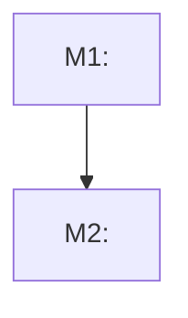
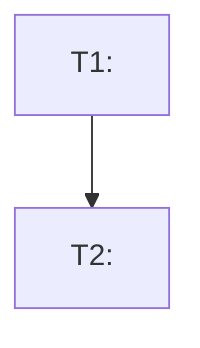

# Stepwise Planner

## Outcome

Produce a markdown plan that matches the requested planning level and lets the next engineer or agent act without guessing the intended scope.

- High-level plans define epics, milestones, or phases as dependency graph nodes with architectural propositions, decisions, questions, risks, and validation points.
- Phase documents consist of `T<N>` implementation task nodes, not steps.
- Low-level plans divide a phase, feature, fix, or refactor into small implementation task nodes that can be reviewed and verified independently.
- Dependency metadata in task fields is the source of truth. Mermaid diagrams are derived views and must match the fields.

## Choose the Planning Level

Use **high-level planning** when the user asks for a roadmap, milestone list, phase plan, architecture direction, or the parts of a single milestone. High-level plans should clarify system direction and tradeoffs before implementation details.

Use **low-level planning** when the user asks to divide a phase, feature, bug fix, refactor, or already-chosen direction into implementation tasks. Low-level plans may refer to existing or planned code entities, files, APIs, tests, modules, data shapes, and verification commands.

If the requested level is unclear, infer from scale:

- Broad goal, multi-module initiative, or architecture uncertainty: high-level.
- Concrete feature/fix/refactor with known target behavior: low-level.
- Ask only when the ambiguity would materially change the output.

## Workflow

1. Inspect the current project context before planning.
   - Read existing architecture, implementation plans, contribution notes, module boundaries, and relevant code.
   - If local instructions conflict with the requested direction, raise the conflict before writing the plan.
   - Prefer the repository's current tools, testing style, naming, and planning conventions.

2. Define the planning target.
   - State the goal in one paragraph.
   - State explicit non-goals when they prevent speculative scope.
   - List assumptions and unknowns. Ask only for unknowns that would materially change the plan.

3. Build the plan at the chosen level as a dependency graph.
   - Assign every epic, milestone, phase, or task a stable ID.
   - Use `E<N>` for epics, `M<N>` for milestones, `P<N>` for phases, and `T<N>` for low-level implementation tasks.
   - When writing one epic, milestone, phase, or task per file, name the file `{identifier} - {name}.md`, for example `M1 - Authentication foundation.md`.
   - Store documents in this hierarchy: `work\{epic}.md`, `work\{epic-id}\{milestone}.md`, `work\{epic-id}\{milestone-id}\{phase}.md`, `work\{epic-id}\{milestone-id}\{phase-id}\{task}.md`.
   - In that hierarchy, `{epic}`, `{milestone}`, `{phase}`, and `{task}` are full document filenames using `{identifier} - {name}.md`; `{epic-id}`, `{milestone-id}`, and `{phase-id}` are ID-only directory names such as `E1`, `M1`, and `P1`.
   - For high-level planning, organize milestones or phases around capabilities, architecture decisions, ownership boundaries, and validation points.
   - When planning inside a phase, represent the phase's contents as `T<N>` tasks.
   - For low-level planning, slice the work into small reviewable implementation task nodes.
   - For every node, include explicit `Depends on`, `Enables`, and `Parallelizable with` metadata. Use `None` when no dependency exists.
   - Avoid speculative foundations unless a later listed milestone, phase, or task directly consumes them.

4. Model dependencies and risk.
   - Put contract, data model, boundary, and architecture decisions before dependent implementation.
   - Put high-uncertainty spikes early, but time-box them and define their output.
   - Put broad cleanup after behavior is covered by tests or reviewable acceptance criteria.
   - Do not encode ordering by document position alone. Express ordering through dependency fields.
   - Mark parallelism only when nodes do not share files, public contracts, ordered migrations, or overlapping test surfaces likely to conflict.

5. Emit the requested markdown document or document set.
   - Use concise headings and checklists.
   - Include enough detail for the chosen level, but do not mix high-level roadmap planning with task-level implementation unless the user asks for both.
   - End epic, milestone, and phase documents with a Mermaid `flowchart TD` dependency visualization derived from node dependency fields.
   - Include a Mermaid dependency visualization in low-level implementation plans when they contain multiple graph nodes.
   - Do not include motivational prose, project-management filler, or implementation details that belong in code comments.

## High-Level Planning Template

Use this structure for roadmaps, milestones, phase planning, and architecture-direction plans unless the repository already has a stronger planning format:

````markdown
# <Plan Title>

File name: `<identifier> - <name>.md` for each epic, milestone, phase, or task document, such as `E1 - <Epic Name>.md`, `M1 - <Milestone Name>.md`, `P1 - <Phase Name>.md`, or `T1 - <Task Name>.md`. Use only the parent identifier, such as `E1`, `M1`, or `P1`, for nested directories.

Document hierarchy:
- `work\<epic>.md`
- `work\<epic-id>\<milestone>.md`
- `work\<epic-id>\<milestone-id>\<phase>.md`
- `work\<epic-id>\<milestone-id>\<phase-id>\<task>.md`

## Goal
<One short paragraph describing the desired end state.>

## Context
- <Relevant architecture/module constraint>
- <Relevant product, runtime, persistence, compatibility, or ownership constraint>

## Epics / Milestones / Phases

### M1: <Capability or Decision Outcome>
**Purpose:** <Why this milestone or phase exists.>

**Depends on:** <None, or IDs this node requires.>
**Enables:** <IDs this node unlocks.>
**Parallelizable with:** <None, or IDs safe to execute in parallel.>

**Architectural Proposition:** <Preferred direction, boundary, or system shape.>

**Key Work:**
- <Capability, contract, spike, or decision to complete at this level>
- <Next phase-level outcome>

**Open Questions:**
- <Question that materially affects architecture, sequencing, or scope>

**Validation:**
- <Evidence that this milestone or phase is complete enough to plan lower-level work>

### M2: <Capability or Decision Outcome>
...

## Cross-Cutting Risks
- <Risk, tradeoff, or dependency with mitigation>

## Verification / Review Strategy
- <How to review decisions, architecture fit, and readiness for low-level planning>

## Dependency Graph

````

## Low-Level Planning Template

Use this structure for implementation-task plans unless the repository already has a stronger planning format:

````markdown
# <Plan Title>

## Goal
<One short paragraph describing the desired end state.>

## Non-Goals
- <Out-of-scope item>

## Context
- <Relevant architecture/module constraint>
- <Relevant existing or planned file, API, behavior, data shape, or test>

## Assumptions and Open Questions
- Assumption: <Assumption that affects sequencing>
- Question: <Only include if it materially changes the plan>

## Phase Tasks

### T1: <Small Reviewable Outcome>
**Purpose:** <Why this task exists.>

**Depends on:** <None, or task IDs this node requires.>
**Enables:** <Task IDs this node unlocks, or None.>
**Parallelizable with:** <None, or task IDs safe to execute in parallel.>

**Changes:**
- [ ] <Specific implementation task touching files, APIs, tests, docs, or assets>
- [ ] <Next concrete implementation task if needed>

**Acceptance Checks:**
- [ ] <Build/test/manual check with expected result>
- [ ] <Review criterion that proves the task is complete>

**Risks:** <Risk and mitigation, or "None identified.">

### T2: <Small Reviewable Outcome>
...

## Verification Strategy
- <Command or manual verification that should run after narrow tasks>
- <Full build/test command for final validation>

## Review Boundaries
- <Suggested commit/PR grouping>

## Deferred Work
- <Useful but intentionally postponed work>

## Dependency Graph

````

## High-Level Quality Rules

- Prefer architectural propositions, decision points, tradeoffs, and questions over premature implementation tasks.
- Do not name concrete classes, files, or methods unless they already exist or are clearly planned architecture entities.
- Surface module boundaries, ownership, data flow, persistence/runtime implications, compatibility constraints, and unresolved tradeoffs.
- Keep phase or milestone completion observable through decisions, artifacts, spikes, acceptance criteria, or readiness for low-level planning.
- Give every epic, milestone, and phase a stable ID and dependency fields.
- Use only `E<N>` for epics, `M<N>` for milestones, and `P<N>` for phases.
- Name every epic, milestone, phase, and task document `{identifier} - {name}.md`.
- Store graph documents under `work\{epic}.md`, `work\{epic-id}\{milestone}.md`, `work\{epic-id}\{milestone-id}\{phase}.md`, and `work\{epic-id}\{milestone-id}\{phase-id}\{task}.md`, where ID directory placeholders are ID-only names and document placeholders are full `{identifier} - {name}.md` filenames.
- End epic, milestone, and phase documents with a Mermaid dependency graph that matches the dependency fields.
- Avoid over-specifying implementation details that belong in a later low-level plan.

## Low-Level Task Quality Rules

- Use verbs in task titles: "Add", "Extract", "Validate", "Wire", "Document".
- Use stable task IDs in task titles, such as `T1: Add ...`.
- Keep each task node independently understandable without reading every later node.
- Make "done" observable: a passing test, a new API contract, a generated artifact, or a documented decision.
- Format every concrete implementation task as an unchecked markdown task item (`- [ ] ...`) so implementers can mark completed work in the plan.
- Use checkboxes for task-level implementation tasks and acceptance checks; avoid checkboxes for explanatory bullets that are not actionable.
- Include `Depends on`, `Enables`, and `Parallelizable with` metadata for every task node. Use `None` explicitly when empty.
- Include a Mermaid dependency graph when a low-level plan has more than one task node.
- Include expected code or artifact changes, tests, build commands, manual checks, or inspection criteria.
- Include rollback or stop criteria when a task is risky.
- Avoid tasks that combine unrelated concerns such as API design, storage migration, UI polish, and cleanup.
- Do not create tasks like "clean up code" unless the cleanup target and verification are explicit.
- Do not use vague acceptance checks such as "works correctly"; name the observable behavior.
- Keep estimates out unless the user explicitly asks for them.

## Critical Review Pass

Before finalizing the document, check for:

- Planning level mismatch: high-level plans with premature implementation detail, or low-level plans too vague to execute.
- Hidden big-bang phases or tasks that should be split.
- Milestones, phases, or tasks that cannot be reviewed because they lack concrete outputs.
- Architecture violations or dependency direction mistakes.
- Missing questions around unresolved architecture, ownership, persistence, compatibility, or runtime behavior.
- Missing tests around changed contracts, serialization, persistence, or user-visible behavior in low-level plans.
- Speculative abstractions not required by the stated goal.
- Ordering errors where implementation precedes required contract, data, or architecture decisions.
- Dependency cycles, missing dependency IDs, stale Mermaid edges, or Mermaid nodes that do not match dependency fields.
- Epic, milestone, or phase IDs that do not follow `E<N>`, `M<N>`, or `P<N>`.
- Epic, milestone, phase, or task document filenames that do not follow `{identifier} - {name}.md`.
- Epic, milestone, phase, or task documents outside the required `work\...` hierarchy.
- Hidden sequential assumptions where task order appears only through document order instead of `Depends on`.
- Unsafe parallelism labels for nodes that share files, public contracts, migrations, or overlapping test surfaces.
